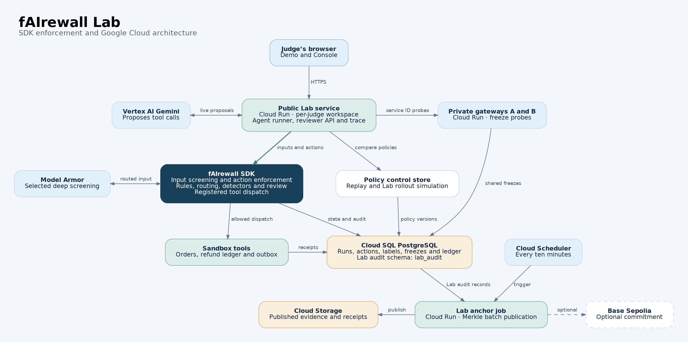
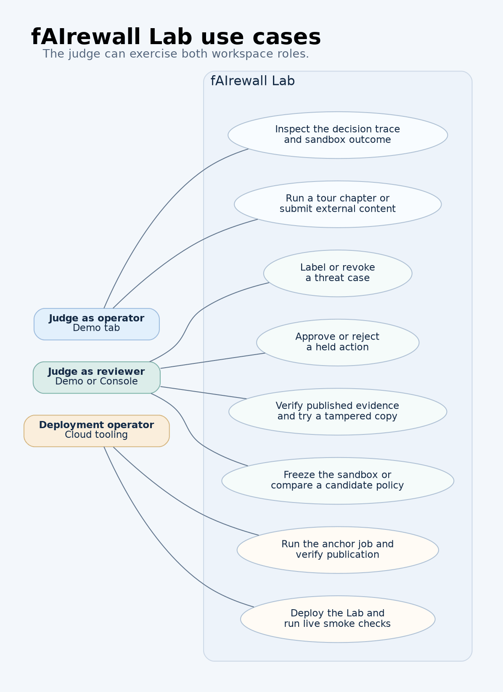

# fAIrewall and the Buildathon Lab

fAIrewall is a Python SDK and HTTP gateway that enforce policy when AI agents read external content or try to use tools. A team's agent can propose actions such as sending a message, exporting information, or issuing a refund. fAIrewall checks whether the action is permitted for that agent, in that run, with those arguments. The governed runtime decides whether the tool actually executes.

The Buildathon Lab is an interactive example built on the SDK. Each judge gets an isolated sandbox and can act as both the agent operator and a simulated reviewer. Gemini can propose actions live through Vertex AI. A clearly labeled recorded mode produces reproducible proposals for the tour. Both modes use the same policy and dispatch path. All orders, refunds, recipients, and deliveries in the Lab are synthetic.

## Architecture

### How a run works

1. **Establish context.** The Lab creates a workspace and gives it distinct operator and reviewer permissions. The server assigns the agent identity and labels where content came from. An operator message, customer email, website fixture, and call transcript can carry different trust.
2. **Screen the input.** Deterministic inbound checks look for recognizable instruction patterns. The router can invoke a local detector or Google Model Armor when the configured policy calls for a deeper check. External content can taint the run even when it reads like ordinary text. A blocked or held input is withheld from the proposing agent.
3. **Get a proposal.** Gemini receives registered tool definitions and returns a proposed tool call. Recorded mode supplies the proposal from a fixture or a labeled local script. The proposal includes the requested tool and arguments. fAIrewall owns the subsequent decision.
4. **Enforce action policy.** The durable action runtime applies the kill switch, argument and role restrictions, run scope, trust restrictions, spend and rate limits, egress rules, and applicable detector, canary, baseline, and memory checks. The trace records which controls ran and which were skipped. Model Armor's filter outcome and the score mapped by fAIrewall are shown separately.
5. **Allow, hold, or block.** An allowed action can reach a registered sandbox handler. A held action appears in the review queue without creating a receipt or delivery. A block refuses execution and records the deciding rule. Approval rechecks current policy and context before dispatch. The action's idempotency key protects the sandbox ledger and outbox against duplicate writes.
6. **Capture evidence.** Tool outputs are screened on the way back to the agent. The Console links the run, action, reviewer decision, and external effect through shared identifiers. The Lab writes hash-chained audit records into its own PostgreSQL audit schema. The scheduled job seals batches into a Merkle tree and publishes the commitment with its evidence metadata to Cloud Storage. An optional Base Sepolia transaction records the commitment. A verifier can check whether a particular record matches the published commitment.

### Which controls do what?

| Control | What a team can enforce or observe |
| --- | --- |
| Tool permissions and run scope | Restrict an agent to particular tools and orders. Route an out-of-scope action to a reviewer or block it, depending on policy. |
| Provenance and taint | Apply tighter action restrictions after the agent reads external data, even when the content contains no detected injection. |
| Financial and velocity rules | Block actions above transaction or session budgets, or repeated tool use above rate limits. |
| Input, payload, output, and egress checks | Detect recognizable suspicious content, enforce destination restrictions, and screen tool outputs. |
| Action baselines and canaries | Hold an unfamiliar action that otherwise falls within policy. Block a trip involving a synthetic decoy and freeze the run. |
| Adaptive threat memory | Apply a review label to sufficiently similar later cases within the same workspace. A trace records the related case, and the reviewer can revoke its label. |
| Kill switch | Stop new governed actions in a selected scope. The fleet exercise probes two gateway services for their decisions. Previously dispatched effects are still visible. |
| Policy replay and audit verification | Compare a candidate against the same history while retaining the active policy. Verify a copy of a record against its batch proof. |

### Deployment boundaries

Cloud Run hosts the public Lab and the private gateway and control-plane services. The Lab runs its governed action dispatch inside the SDK. The two remote gateways are used for the fleet freeze probes, so a probe checks a gateway decision while the Lab separately verifies that its own dispatch was refused. The Lab's policy comparison and observation display reads from its control store. Treat it as a rollout simulation until the remote services report their applied policy fingerprints.

Cloud SQL provides PostgreSQL state, and the Lab's scheduled anchor job targets `lab_audit`. Cloud Scheduler triggers the Cloud Run job every ten minutes. The job verifies publication separately from sealing. Cloud Build and Artifact Registry deliver the container image. Runtime identities use IAM for Google APIs and Secret Manager for service secrets. Logs and trace measurements can be used to correlate a run with deployment events.

## Use cases

| Actor | Representative workflow | Evidence |
| --- | --- | --- |
| Judge acting as operator | Select a chapter or submit a message, then inspect the proposed tool call and decision | Input source, proposal provenance, policy finding, and sandbox effect |
| Judge acting as reviewer | Open a held action in Console, review it, and return to the run | Reviewer event, policy recheck, and at most one delivery or receipt |
| Judge exercising threat memory | Label a case, run a related fixture, and inspect the case linked to its verdict | Case ID, learned finding, and revocation control |
| Judge exercising the kill switch | Freeze the workspace's agent and probe both gateways | Distinct service identities, freeze findings, and refused governed dispatch |
| Deployment operator | Deploy the Lab, run live smoke checks, and publish a new audit batch | Vertex proposal, live Model Armor filter response, gateway acknowledgments, and verified published proof |

## What to show judges

Start with the over-cap chapter to show a deterministic block and an unchanged ledger. Next, use the clean website variant to show the deep check and the effect of untrusted provenance. Open the held destination case from **Console → Approvals & learning**, approve it, and return to Demo to show the single delivery. Finish with the learning or evidence chapter and open the trace behind its result.

Use live results when making claims about Google Cloud. Recorded runs demonstrate the SDK's enforcement path with reproducible proposals. They do not measure provider availability or detector coverage. A valid audit proof establishes that a record matches a published commitment. It does not establish the underlying business claim was true. The **Honest Limits** view reports measured timings and describes where the controls rely on provenance, configured rules, and reviewed examples.

For deploy commands, smoke checks, and a rehearsal with a newly published record, see the [Google Cloud runbook](../deploy/gcp/README.md).
